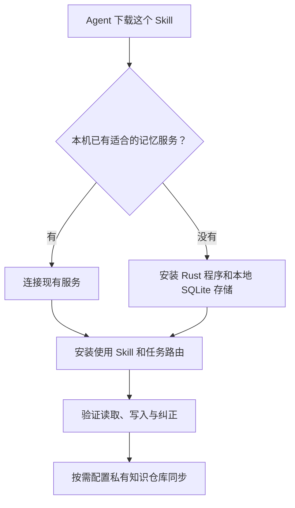

# ai-memory-connect

给 Agent 一个链接，让它在自己的电脑上接入个人知识库：**已有服务就共用，没有才安装。**

把下面这句话发给 Muse、Codex 或其他能操作自己环境的 Agent：

> 请读取 https://github.com/KUSTLiWei/ai-memory-connect ，安装其中的 ai-memory-connect Skill，并按 Skill 完成接入。先检查本机是否已有可复用服务；有就接入，没有再安装。由你操作自己的运行环境，完成后汇报实际读写、自动提取和 Git 同步状态。

## 安装 Skill

1. 下载此仓库，读取 [`skills/ai-memory-connect/SKILL.md`](skills/ai-memory-connect/SKILL.md)。
2. 将 `skills/ai-memory-connect/` 复制到当前 Agent 实际使用的 Skill 目录。
3. 保留 Skill 目录中的 `references/`，确认 Agent 能发现此 Skill，再执行接入流程。

同一台机器上的多个 Agent 共用一个服务和一份本地数据；不同机器各自运行服务，
通过另行授权的私有知识仓库交换知识。MCP 是访问接口，不要求服务固定运行在某台 Mac。

此仓库只放公开安装说明，不放个人记忆或凭据。自动提取需要本机模型授权；自动
GitHub 提交推送需要单独配置同步任务。安装程序本身不代表这两项已开启。

代码来源和固定版本见 [固定程序版本](skills/ai-memory-connect/references/runtime.md)。本仓库提供接入 Skill，不分发预编译程序。

程序和个人知识库保持私有。Agent 先使用本机已有的 GitHub 授权；没有权限时请你在
该机器登录，成功后继续。需要密钥时通过本机凭据工具录入，不写进 Skill、仓库或聊天。
Skill 本身可公开下载，不附带任何访问权限。
